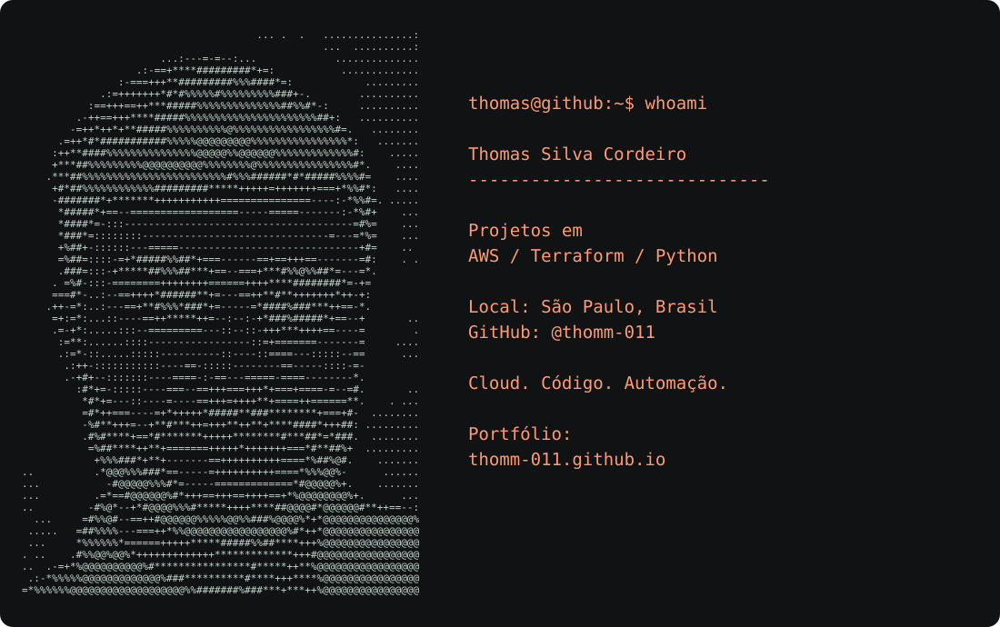

# Hi, I'm Thomas Silva Cordeiro

I have **3 years of experience in the field**, working across cloud infrastructure, Kubernetes, CI/CD, and application development. My work includes deploying and integrating AI platforms with Amazon Bedrock.

Based in **São Paulo, Brazil**. I connect infrastructure and applications: from Terraform and delivery pipelines to Python crawlers, Angular interfaces, and AI platform integrations.

**[Explore my portfolio](https://thomm-011.github.io/portfolio/)** · [LinkedIn](https://www.linkedin.com/in/thomas-s-923082184/)

## Selected professional contributions

My professional contributions include projects from Aquarela, Tele Sena, Renda Fácil, **[Hike](https://github.com/go-hike)**, and **[Total Acesso](https://github.com/totalacesso)**.

### AI, FinOps, Kubernetes, and cloud delivery

- **[bedrock-access-gateway · Aquarela](https://thomm-011.github.io/portfolio/#case-bedrock-access-gateway)** — Deployment and integration work around an existing Amazon Bedrock gateway in the context of AI platforms.
- **[mcp-finops · Aquarela](https://thomm-011.github.io/portfolio/#case-mcp-finops)** — Contributions to configuring and deploying a FinOps MCP component on Kubernetes.
- **[modernizacao-eks-lidercap · Aquarela / Lidercap](https://thomm-011.github.io/portfolio/#case-modernizacao-eks-lidercap)** — Configured Kubernetes components and operational automation in a modernization project covering 10 EKS clusters.
- **[karpenter-lidercap · Aquarela / Lidercap](https://thomm-011.github.io/portfolio/#case-karpenter-lidercap)** — Configured and tuned Karpenter capacity provisioning as part of a team initiative that reduced EKS EC2 costs by 28% between January and May 2026.
- **[KEDA + Amazon SQS · Aquarela / Lidercap](https://thomm-011.github.io/portfolio/#case-keda-sqs)** — Configured KEDA ScaledObjects and AWS SQS triggers for worker replica scaling in a project with 48 SQS queues. Karpenter supplied node capacity; KEDA controlled application replicas.
- **[aws-stack-telesena · Tele Sena](https://thomm-011.github.io/portfolio/#case-telesena)** — Contributions to modular Terraform infrastructure on AWS and automated/scheduled routines.
- **[rendafacil-services · Renda Fácil](https://thomm-011.github.io/portfolio/#case-rendafacil)** — Configured infrastructure, CI/CD, and delivery for a Go monorepo with API, worker, migration, and backoffice integration components; SQS, LocalStack, and New Relic are part of the project.

**Shared project scope · Lidercap / Aquarela · January–May 2026:** 10 EKS clusters, 48 SQS queues, and a team result of 28% lower EKS EC2 costs with Karpenter. These figures describe the same initiative across the EKS, Karpenter, and KEDA cases.

### Other collaborative work

- **GCP infrastructure as code · Hike** — Configured Terraform infrastructure with BigQuery, Cloud Functions, Pub/Sub, Cloud Scheduler, Cloud SQL, Cloud Storage, networking, and compute components.
- **AWS infrastructure · Total Acesso** — Adjusted CloudFormation/Terraform configurations and CI/CD around VPC, EC2, ECS, RDS, S3, CloudFront, IAM, and CloudWatch resources.
- **Application delivery · Hike** — Configured GitHub Actions workflows for Docker image builds, publishing, and Kubernetes delivery on GCP using gcloud and kubectl.
- **Data crawler · Total Acesso** — Developed and adjusted data collection/processing routines with Python, Playwright, and pandas.
- **Web Facial · Total Acesso** — Developed and adjusted web interface features with Angular and TypeScript.

These are collaborative professional projects. Source code and internal implementation details remain private.

**[Read the case summaries](https://thomm-011.github.io/portfolio/#experiencia)**

## AWS certifications

- **[AWS Certified Solutions Architect – Associate](https://www.credly.com/badges/28c2c38c-5444-4084-a693-8456c6d1b2ef)** · valid through 2028-05-09.
- **[AWS Certified Developer – Associate](https://www.credly.com/badges/6d5a5af2-b8a4-43fa-b005-94b2c9bf84b0)** · valid through 2028-09-24.
- **[AWS Certified Cloud Practitioner](https://www.credly.com/badges/e1909cec-0e91-40f9-bbb8-58a3bb7d4431)** · valid through 2028-09-24.
- **[AWS Certified AI Practitioner](https://www.credly.com/badges/5af590ae-84fd-439a-82ac-864ac9e4b1f9)** · valid through 2029-07-17.

[All credentials on Credly](https://www.credly.com/users/thomas-silva-cordeiro/badges)

## Selected public projects

### [mcp-aws-finops](https://github.com/thomm-011/mcp-aws-finops)

A read-only MCP server that lets an AI agent (Claude, Cursor, Hermes) answer AWS cost questions in plain language — 7 tools (cost summary, period comparison, top cost drivers, cost by tag with % untagged, idle resources, month-end forecast, anomaly explanation), a weekly report resource, and a review prompt. Runs fully offline over synthetic FOCUS-format billing data (86 tests, 96% coverage); verified end-to-end with a real agent (Hermes + Claude Haiku). Similar theme to the **[mcp-finops · Aquarela](https://thomm-011.github.io/portfolio/#case-mcp-finops)** professional case, but a separate, generic public project — not that code.

**Focus:** FinOps tooling for AI agents via MCP. Optional AWS Cost Explorer backend with a least-privilege IAM policy and Terraform role module, tested with stubs/mocks (not yet validated against a live account).

`MCP` `Python` `DuckDB` `FastMCP` `FinOps`

### [Muralha](https://github.com/thomm-011/muralha)

A security copilot for people building with AI agents: skills that guide the agent through charter, detection, planning, hardening, and verification, plus a CLI and a local dashboard. No API key required. Findings are mapped to the OWASP Top 10:2025, and the report can fail a pull request in CI. Published on [npm](https://www.npmjs.com/package/muralha) with provenance. **In one demo project with 11 deliberate flaws, detection found all 11; this is a small test on a single project.**

**Focus:** security review and hardening for AI-assisted development.

`TypeScript` `Node.js` `OWASP` `GitHub Actions`

### [EKS Autoscaling Lab](https://github.com/thomm-011/eks-autoscaling-lab)

A generic reference lab with a synthetic SQS worker, KEDA ScaledObjects, a Karpenter NodePool, and Terraform queue/identity configuration. Uses an existing disposable EKS cluster as a prerequisite. **Offline tests only so far; not yet deployed on AWS.**

`EKS` `Karpenter` `KEDA` `SQS` `Terraform`

### [Terraform AWS Webapp](https://github.com/thomm-011/terraform-aws-webapp)

Infrastructure as code for a web application on AWS, including a VPC, Application Load Balancer, EC2 Auto Scaling, RDS MySQL, S3, and CloudWatch alarms.

**Focus:** reproducible provisioning, network segmentation, and configurable infrastructure.

`Terraform` `AWS` `HCL`

### [AWS Inventory Scanner](https://github.com/thomm-011/aws-inventory-scanner)

A Python CLI for discovering AWS resources, exporting inventories, and comparing scans to identify changes in an environment.

**Focus:** cloud visibility, resource discovery, and reporting.

`Python` `Boto3` `AWS` `CLI`

### [Disk Usage Analyzer](https://github.com/thomm-011/disk-usage-analyzer)

A disk usage analysis tool with web and command-line interfaces, directory visualizations, and filters for investigating storage consumption.

**Focus:** turning filesystem data into useful operational information.

`Python` `Flask` `CLI`

### [AWS Cost Monitor](https://github.com/thomm-011/aws-cost-monitor)

A Python tool for querying AWS costs, comparing spending across periods, checking configured limits, and exporting reports.

**Focus:** cost visibility and configurable budget checks.

`Python` `Boto3` `AWS Cost Explorer`

## What you'll find here

- Cloud infrastructure and Terraform configurations.
- Python tools for inventory, reporting, and operational tasks.
- Security tooling for AI-assisted development.
- Documentation to explore the architecture and run each project.

## Get in touch

**[thomassilvacordeiro@gmail.com](mailto:thomassilvacordeiro@gmail.com)**

[Portfolio](https://thomm-011.github.io/portfolio/) · [LinkedIn](https://www.linkedin.com/in/thomas-s-923082184/) · [Repositories](https://github.com/thomm-011?tab=repositories)
